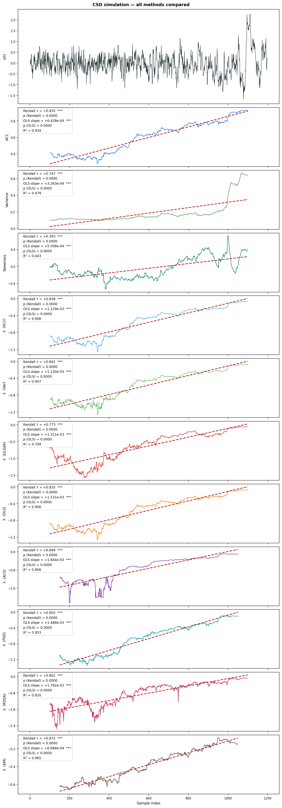
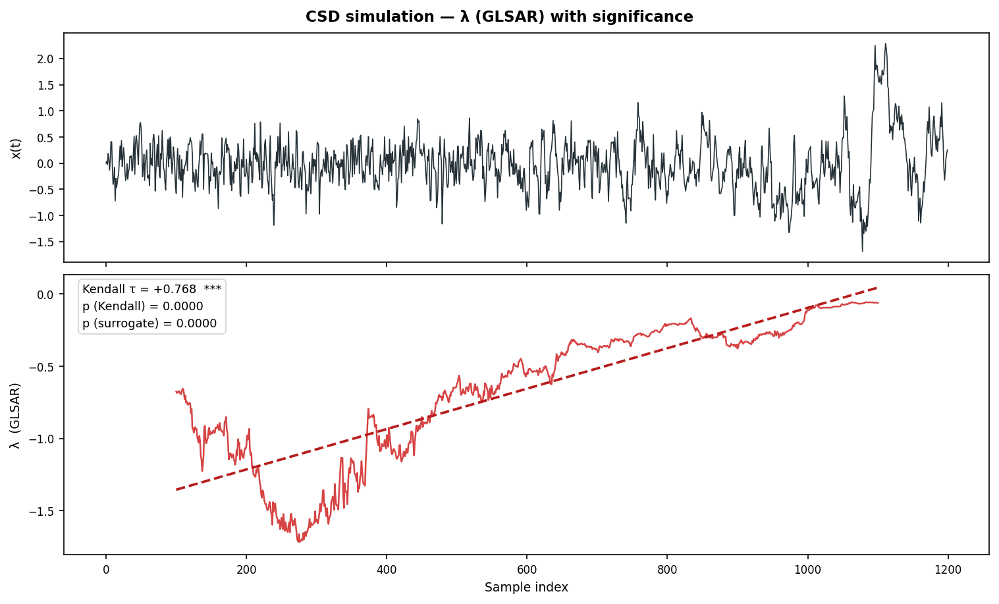
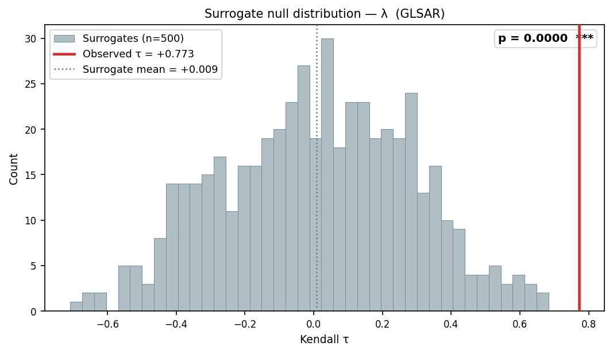
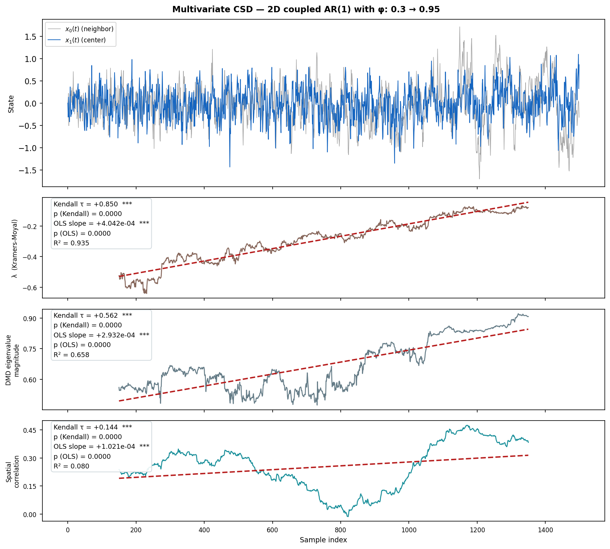

# CSDTools — Critical Slowing Down Analysis Toolkit

A unified Python toolkit for detecting loss of resilience in dynamical systems
using **Critical Slowing Down (CSD)** theory.  The package consolidates
several methods into a single, consistent API.

---

## Table of Contents

1. [Background: What is CSD?](#1-background-what-is-csd)
2. [Mathematical Framework](#2-mathematical-framework)
3. [Available Methods](#3-available-methods)
   - [Lag-1 Autocorrelation (AC1)](#lag-1-autocorrelation-ac1)
   - [Variance](#variance)
   - [Skewness](#skewness)
   - [Lambda via AC1](#lambda-via-ac1)
   - [Lambda via Variance](#lambda-via-variance)
   - [Lambda via GLSAR](#lambda-via-glsar)
   - [Lambda via OLS](#lambda-via-ols)
   - [Lambda via ACS](#lambda-via-acs)
   - [Lambda via PSD](#lambda-via-psd)
   - [Lambda via Kramers-Moyal](#lambda-via-kramers-moyal)
   - [Lambda via DMD](#lambda-via-dmd)
   - [ROSA (Ratio of Spectra)](#rosa-ratio-of-spectra)
   - [Spatial Correlation](#spatial-correlation)
   - [Empirical Recovery Rate](#empirical-recovery-rate)
4. [Installation](#4-installation)
5. [Workflow](#5-workflow)
   - [Step 1 — Load your data](#step-1--load-your-data)
   - [Step 2 — Choose a preprocessing method](#step-2--choose-a-preprocessing-method)
   - [Step 3 — Choose an indicator method](#step-3--choose-an-indicator-method)
   - [Step 4 — Run the analysis](#step-4--run-the-analysis)
   - [Step 5 — Visualise the results](#step-5--visualise-the-results)
   - [Step 6 — Assess statistical significance](#step-6--assess-statistical-significance)
   - [Step 7 — Compare multiple methods](#step-7--compare-multiple-methods)
   - [Handling missing data (NaNs)](#handling-missing-data-nans)
6. [Multivariate Analysis](#6-multivariate-analysis)
7. [Full API Reference](#7-full-api-reference)
8. [Preprocessing Guide](#8-preprocessing-guide)
9. [Significance Testing](#9-significance-testing)
10. [Plotting](#10-plotting)
11. [Examples](#11-examples)
12. [References](#12-references)

---

## 1. Background: What is CSD?

Many natural and engineered systems can transition abruptly between
qualitatively different states — *tipping points* — when an external
parameter crosses a critical threshold.  Examples include:

- The Atlantic Meridional Overturning Circulation (AMOC) collapsing.
- Amazon rainforest dieback due to warming and deforestation.
- Arctic sea-ice loss transitioning to a seasonally ice-free state.
- Ecological regime shifts (e.g., from coral reef to algae-dominated).

Near such a tipping point, the dynamical system **slows down**: it takes
longer to return to equilibrium after being disturbed.  This phenomenon is
called **Critical Slowing Down** and it produces measurable statistical
fingerprints in observed time series *before* the transition occurs —
making it a potential early warning signal.

---

## 2. Mathematical Framework

### The OU process near a bifurcation

Close to a saddle-node bifurcation, the dynamics of a system variable *x*
around its equilibrium can be linearised to an **Ornstein-Uhlenbeck (OU)**
process:

```
dx = λ x dt + σ dW
```

where:
- **λ < 0** is the *linear restoring rate* (stability parameter).
- **σ > 0** is the noise amplitude.
- **W** is a Wiener process (white noise).

As the system approaches the bifurcation, **λ → 0** from below.  This is
Critical Slowing Down.

### Discrete-time equivalent

In discrete time with step Δt the OU process becomes an AR(1) model:

```
x(t + Δt) = φ x(t) + ε(t),     φ = exp(λ Δt)
```

For a stable system **φ ∈ (0, 1)**.  At the tipping point **φ → 1**.

### Observable consequences of CSD

| Indicator | Formula | CSD behaviour |
|-----------|---------|---------------|
| AC1 | `⟨x(t)x(t+Δt)⟩ / Var(x)` ≈ φ | Increases toward 1 |
| Variance | `σ²/(1 − φ²)` | Increases toward ∞ |
| Skewness | third standardised moment | \|skewness\| increases |
| Restoring rate | `λ = log(φ)/Δt` | Increases toward 0 |

All methods in csdtools either estimate **λ** directly or track **AC1**,
**variance**, and **skewness** as proxies.

---

## 3. Available Methods

### Lag-1 Autocorrelation (AC1)

**Method name**: `'ac1'`

The simplest CSD indicator.  For an AR(1) process the expected lag-1
autocorrelation equals φ = exp(λΔt).  As λ → 0, AC1 → 1.

**Pros**: Fast, easy to interpret, widely established.  
**Cons**: Only uses one lag; does not directly estimate λ.

```python
result = analyze_timeseries(x, method='ac1', window_size=100)
```

**References**: [Held & Kleinen (2004)][Held2004]; [Dakos et al. (2008)][Dakos2008].

---

### Variance

**Method name**: `'variance'`

The steady-state variance of the OU process is σ²/(1 − φ²).  As φ → 1,
variance diverges.

**Pros**: Fast, complementary to AC1.
**Cons**: Sensitive to changes in noise amplitude σ that are not caused by CSD.

```python
result = analyze_timeseries(x, method='variance', window_size=100)
```

**References**: [Held & Kleinen (2004)][Held2004]; [Dakos et al. (2008)][Dakos2008].

---

### Skewness

**Method name**: `'skewness'`

Near a fold (saddle-node) bifurcation the effective potential well becomes
asymmetric, so the distribution of fluctuations develops a non-zero skew.
The magnitude of skewness increases as the system approaches the tipping
point; the sign depends on the direction of the bifurcation.

Computed as the bias-corrected (adjusted Fisher-Pearson) standardised third
moment, equivalent to `scipy.stats.skew(x, bias=False)`.

**Pros**: Captures asymmetric departures from Gaussianity not reflected in
AC1 or variance; useful cross-check.
**Cons**: Higher-order statistic — requires larger windows for reliable
estimates (≥ 100 samples recommended); sign is not universally predictable.

```python
result = analyze_timeseries(x, method='skewness', window_size=100)
```

---

### Lambda via AC1

**Method name**: `'lambda_ac1'`

Converts the Pearson lag-1 autocorrelation coefficient φ directly to a
continuous-time restoring rate via `λ = log(φ)/Δt`.  φ is computed as the
Pearson correlation between consecutive pairs `x[t]` and `x[t+1]`.

This is the simplest parametric λ estimator.  Unlike `lambda_ols` (which uses
the Yule-Walker covariance ratio), this uses the normalised Pearson correlation
and is therefore bounded between −1 and 1.  For a stationary AR(1) process the
two estimators are asymptotically equivalent.

**Pros**: Extremely fast; interpretable; directly tied to the AC1 indicator.
**Cons**: Uses only one lag; slightly noisier than multi-lag estimators.

```python
result = analyze_timeseries(x, method='lambda_ac1', window_size=100)
```

**References**: [Smith & Boers (2023)][SmithBoers2023].

---

### Lambda via Variance

**Method name**: `'lambda_var'`

Estimates λ from the ratio of the OLS residual noise variance to the stationary
variance.  For a stable OU process with per-step noise variance σ²_noise and
stationary variance V:

```
λ = (1/2) · log(1 − σ²_noise / V) / Δt
```

σ²_noise is obtained from the residuals of the OLS regression
`dx = λ_step · x[t] + ε`.

**Pros**: Independent of the autocorrelation structure; complementary to
AC1-based estimators.
**Cons**: Sensitive to variance changes caused by noise amplitude shifts rather
than CSD; requires that σ²_noise < V (not guaranteed in very short windows).

```python
result = analyze_timeseries(x, method='lambda_var', window_size=100)
```

**References**: [Smith & Boers (2023)][SmithBoers2023].

---

### Lambda via GLSAR

**Method name**: `'lambda_glsar'`  *(recommended default)*

Fits the AR(1) regression `x(t) = φ x(t−1) + ε(t)` using **Generalised
Least Squares** with an AR(1) residual covariance structure (statsmodels
`GLSAR`), then computes `λ = log(φ)/Δt`.

The key advantage of GLS over plain OLS is that it accounts for the fact
that the regression residuals ε(t) are themselves autocorrelated.  Ignoring
this leads to a downward bias in φ.

**Pros**: Accurate, well-established in the CSD literature.  
**Cons**: Slightly slower than OLS; requires ≥ 30 samples per window.

```python
result = analyze_timeseries(x, method='lambda_glsar', dt=1.0, window_size=100)
```

**References**: [Boers (2021)][Boers2021].

---

### Lambda via OLS

**Method name**: `'lambda_ols'`

Uses the Yule-Walker estimator (least-squares regression) to estimate φ:

```
φ̂ = Cov(x[t], x[t−1]) / Var(x[t−1])
```

then `λ = log(φ̂)/Δt`.

**Pros**: Very fast.  
**Cons**: Slightly biased downward in short windows relative to GLSAR.

```python
result = analyze_timeseries(x, method='lambda_ols', window_size=100)
```

---

### Lambda via ACS

**Method name**: `'lambda_acs'`

Fits the **theoretical autocorrelation structure** of the OU process to the
observed empirical ACF.  For an OU process, `C(τ) = exp(λ τ)`, so fitting
this to multiple observed lags simultaneously gives a robust estimate of λ.

The number of lags used is controlled by the `max_lag` parameter.

**Pros**: Uses more information (multiple lags) than a single-lag estimator;
robust to moderate noise.  
**Cons**: Requires solving a nonlinear optimisation; ≥ 300 samples recommended.

```python
result = analyze_timeseries(x, method='lambda_acs', window_size=300,
                            max_lag=20)
```

**References**: [Morr & Boers (2024)][Morr2024a].

---

### Lambda via PSD

**Method name**: `'lambda_psd'`

Fits a two-mode discrete-time PSD model to the band-averaged log-periodogram.
The theoretical spectrum has poles at exp(−λ) and exp(−θ); the dominant
(smallest) rate is returned as the restoring-rate estimate.  Band averaging
with 10 bins per band is applied before fitting to reduce periodogram noise.

**Pros**: Uses all available frequency information; independent of
time-domain autocorrelation estimates.
**Cons**: Sensitive to spectral leakage; ≥ 300 samples recommended for reliable fits.

```python
result = analyze_timeseries(x, method='lambda_psd', window_size=300)
```

**References**: [Morr & Boers (2024)][Morr2024a].

---

### Lambda via Kramers-Moyal

**Method name**: `'lambda_km'`

Uses the **Kramers-Moyal expansion** to estimate the drift coefficient
non-parametrically.  For an OU process the first Kramers-Moyal coefficient
(drift) is `D¹(x) = λ x`, so the slope of D¹ vs x gives λ directly.

This method makes *no assumption* about the functional form of the noise
beyond the Markov property, making it valuable when the underlying process
may deviate from the simple OU model.

For **multivariate input** (shape `(n_dims, n_samples)`), the full drift
Jacobian B is estimated and the dominant (least-negative) real eigenvalue
is returned.  See [Multivariate Analysis](#6-multivariate-analysis).

**Pros**: Non-parametric; detects nonlinear effects; supports nD input.
**Cons**: Requires substantially more data (≥ 200 samples recommended);
requires the `kramersmoyal` package.

```python
# Univariate
result = analyze_timeseries(x, method='lambda_km', dt=1.0,
                            window_size=300, bin_number=50)

# Multivariate — x_nd has shape (n_dims, n_samples)
result = analyze_timeseries(x_nd, method='lambda_km', window_size=300)
```

**References**: [Morr et al. (2024)][Morr2024b].

> **Reproducing the original paper.** The Kramers-Moyal estimator in
> Morr et al. (2024) used a data-adaptive kernel bandwidth
> `bw = 14 · σ_window / bin_number` (with `σ_window` the standard deviation of
> the window) and detrended each window while **keeping its mean**, selecting
> the retained bins symmetrically around that mean (the stable state). The
> defaults here instead delegate the 1-D bandwidth to `kramersmoyal` and
> detrend each window to zero mean, so estimates differ slightly. To reproduce
> the original, use `bin_number=50` and `center_fraction=0.5` and pass an
> explicit `bw`; note that the original bandwidth is *per-window adaptive*
> (`14·σ_window/bin_number`), which the single scalar `bw` argument can only
> match exactly when the window variance is roughly constant. The nD branch
> already applies the `n_dims·14/bin_number` heuristic internally.

---

### Lambda via DMD

**Method name**: `'lambda_dmd'`

Uses **Dynamic Mode Decomposition** to fit the linear operator A such that
A·X ≈ Y, where columns of X and Y are consecutive state snapshots.  The
dominant eigenvalue magnitude is the CSD indicator: it sits in (0, 1) for
a stable system and increases toward 1 as the system approaches a
bifurcation.

For **1D input**, a time-delay (Hankel) embedding lifts the scalar series
into a higher-dimensional state space before fitting DMD.  For **nD input**
(shape `(n_dims, n_samples)`) the multiple variables form the state directly;
embedding is applied per dimension if `embedding_dim > 1`.

**CSD signature**: dominant eigenvalue magnitude increases toward 1.

**Pros**: Works on both 1D and nD data with the same interface; captures
non-normal dynamics; time-delay embedding allows reconstruction of
attractor geometry from a 1D observable.
**Cons**: Requires the `pydmd` package; for 1D signals a higher
`embedding_dim` (e.g. 3–10) is recommended for richer state representation.

```python
# Univariate with time-delay embedding
result = analyze_timeseries(x, method='lambda_dmd', window_size=200,
                            embedding_dim=5, tau=3)

# Multivariate — x_nd has shape (n_dims, n_samples)
result = analyze_timeseries(x_nd, method='lambda_dmd', window_size=200)
```

**References**: [Smith et al. (2026)][Smith2026].

---

### DMD — Floquet (seasonal / spatial)

**Method name**: `'lambda_dmd_floquet'`

The seasonal / spatially-extended counterpart of `lambda_dmd`. Instead of a
one-step operator it fits the **period-T monodromy operator** `M` that maps the
(embedded) system state at time *t* to its state one full period later,
*t + T*:

```
M · s(t) ≈ s(t + T)
```

The eigenvalues of `M` are the **Floquet multipliers**; the dominant magnitude
is < 1 for a stable limit cycle and crosses 1 as resilience is lost. Fitting
the period-T map (rather than the one-step map) makes the estimator appropriate
for strongly **seasonal / periodically forced** data, where a one-step DMD is
dominated by the seasonal cycle itself. For **nD input** the state at each time
step is the full (flattened) spatial field, optionally time-delay embedded;
snapshots are mean-centred and standardised per feature before the fit.

**CSD signature**: dominant Floquet-multiplier magnitude increases toward 1.

**Pros**: Designed for seasonal and spatially extended systems; the same
interface handles 1D and nD data.
**Cons**: Requires the `pydmd` package and a window spanning several periods
(`≈ (num_cycles + 1) × period` samples); `period` must be set to the data's
cycle length.

```python
# Monthly data with an annual cycle (period=12); window spans ~4 years
result = analyze_timeseries(x, method='lambda_dmd_floquet', window_size=60,
                            period=12, embedding_dim=1)

# Spatial field — x_nd has shape (n_cells, n_samples)
result = analyze_timeseries(x_nd, method='lambda_dmd_floquet', window_size=60,
                            period=12, dmd_rank=5, standardize=True)
```

Like `lambda_dmd`, this returns an eigenvalue **magnitude**, not a
continuous-time rate.

**References**: [Smith et al. (2026)][Smith2026].

---

### ROSA (Ratio of Spectra)

**Method name**: `'rosa'`

The **Ratio Of Spectra Approach** of Clarke et al. (2023). For a first-order
(OU) system driven by a forcing ξ, the response and forcing spectra are related
through the transfer function:

```
S_xx(ω) = S_ξξ(ω) / (ω² + λ²),   ω = 2π f
```

ROSA fits λ to the **ratio** `R(ω) = S_xx(ω) / S_ξξ(ω) ∝ 1 / (ω² + λ²)`. Because
the forcing spectrum is divided out, the method does **not** assume white
forcing — this is its "beyond white noise" property, appropriate for red/coloured
driving noise. A free amplitude is fitted alongside λ, so a scale mismatch
between a forcing proxy and the true forcing does not bias λ (which is set by the
corner frequency ω = λ).

The forcing spectrum `S_ξξ` is supplied via one of:

- `noise=<time series>` — a forcing/noise series; its periodogram is used. In the
  sliding-window pipeline pass a **full series aligned with `x`**; it is windowed
  in sync with each window, so the forcing spectrum **may vary in time**.
- `noise_psd=<callable S(ω)>` or `noise_psd=(omegas, values)` — an explicit,
  stationary forcing PSD as a function of **angular frequency** ω = 2πf.
- *neither* — a **white** forcing (plain Lorentzian fit to `S_xx`).

**Pros**: Correctly handles coloured/red forcing when the forcing spectrum is
known or can be estimated; time-varying forcing supported via a windowed `noise`
series.
**Cons**: Requires a forcing estimate to realise the "beyond white noise"
benefit; assumes first-order (OU) response dynamics.

```python
# White-forcing fallback (no forcing supplied)
result = analyze_timeseries(x, method='rosa', window_size=100)

# Coloured forcing supplied as an analytic PSD S(ω) (here AR(1)-like red noise)
S = lambda w: 1.0 / (w**2 + 0.5**2)
result = analyze_timeseries(x, method='rosa', window_size=100, noise_psd=S)

# Time-varying forcing: a series aligned with x, windowed in sync
result = analyze_timeseries(x, method='rosa', window_size=100, noise=eta)
```

**References**: [Clarke et al. (2023)][Clarke2023].

---

### Spatial Correlation

**Method name**: `'spatial_corr'`

Quantifies the **spatial correlation** which increase predicted by CSD in
spatially extended systems. 
The *mean spatial correlation* is defined as the average 
Pearson correlation between a center grid cell (center_idx) time series and
all other cells within a user-defined "neighborhood"
(min_dist < d_j <= max_dist).
Note that it reflects the average temporal correlation between neighboring cells.


```python
from csdtools import analyze_timeseries
from csdtools.spatial import compute_distance_matrix

D = compute_distance_matrix(lats, lons)   # pairwise km distances
result = analyze_timeseries(
    data,                    # shape (n_cells, n_time)
    method='spatial_corr',
    window_size=120,
    distance_matrix=D,
)
```

**References**: [Blaschke et al. (2024)][Blaschke2024].

---

### Empirical Recovery Rate

Found in `csdtools.empirical`.  For time series where transitions *have
already occurred*, fits an exponential recovery curve after each transition
to estimate the empirical recovery rate λ_emp.

```python
from csdtools.empirical import empirical_recovery_rate

results = empirical_recovery_rate(x, window_size=100)
for r in results:
    print(r['lambda_empirical'], r['r_squared'])
```

---

## 4. Installation

Clone the repository and install:

```bash
git clone <repo-url>
cd CSDTools
pip install .
```

This installs all required dependencies (`numpy`, `scipy`, `statsmodels`,
`matplotlib`) automatically.

Optional extras for specific methods:

```bash
pip install ".[km]"           # adds kramersmoyal  (method='lambda_km')
pip install ".[dmd]"          # adds pydmd         (method='lambda_dmd')
pip install ".[spatial]"      # adds pyproj        (spatial.compute_distance_matrix)
pip install ".[km,dmd,spatial]"  # all optional dependencies
```

After installation, `import csdtools` works from any directory.

---

## 5. Workflow

This section walks through a complete analysis from raw data to publication-ready
figures.  Each step corresponds to a function in csdtools.

### Step 1 — Load your data

csdtools works with any 1-D NumPy array of evenly-sampled observations.  Load
your data however is most convenient and convert it to an array:

```python
import numpy as np

# From a text file
x = np.loadtxt("my_data.csv", delimiter=",")

# From a NetCDF file via xarray
import xarray as xr
ds = xr.open_dataset("my_data.nc")
x = ds["variable"].values   # shape (T,)

# Or generate synthetic data for testing
rng = np.random.default_rng(42)
T = 1000
phi = np.linspace(0.3, 0.95, T)
x = np.zeros(T)
for t in range(1, T):
    x[t] = phi[t] * x[t - 1] + 0.3 * rng.standard_normal()
```

**Missing values**: NaN and Inf values are stripped automatically.  A warning
is emitted with the count and percentage removed.  See
[Handling missing data](#handling-missing-data-nans) below.

---

### Step 2 — Choose a preprocessing method

Raw observations typically contain a slow trend (seasonal cycle, long-term
mean drift) that must be removed before computing CSD indicators.  Pass the
`detrend` and `detrend_window` arguments to `analyze_timeseries`:

| `detrend=` | Description | Typical use |
|---|---|---|
| `'running_mean'` | Subtract a centred running mean | Default; handles smooth trends |
| `'linear'` | Remove a global linear regression | When trend is approximately linear |
| `'quadratic'` | Remove a global quadratic polynomial | Slow nonlinear drift |
| `'stl'` | STL seasonal decomposition | Seasonal data (requires `period`) |
| `'harmonic'` | Remove fitted sine/cosine harmonics | Known seasonal frequency |

The `detrend_window` controls the bandwidth of the running mean (in samples).
A common rule of thumb: set it to roughly half the length of the series, or
to the dominant cycle length if a periodic signal is present.

```python
# Remove a running mean with a 400-sample bandwidth
result = analyze_timeseries(x, method='lambda_glsar',
                            detrend='running_mean', detrend_window=400)
```

Set `local_detrend=True` to additionally remove a linear trend *within each
sliding window* (reduces spurious trends in the indicator time series for
highly non-stationary data).

---

### Step 3 — Choose an indicator method

| `method=` | What it measures | Input | When to use |
|---|---|---|---|
| `'ac1'` | Lag-1 autocorrelation | 1D | Quick first look; widely cited |
| `'variance'` | Window variance | 1D | Complementary to AC1 |
| `'skewness'` | Third standardised moment | 1D | Cross-check for distributional asymmetry |
| `'lambda_ac1'` | Restoring rate via Pearson AC1 | 1D | Fast; same information as AC1 but as λ |
| `'lambda_var'` | Restoring rate via variance ratio | 1D | Complementary to AC1-based estimators |
| `'lambda_glsar'` | Restoring rate via GLS | 1D | **Recommended default** |
| `'lambda_ols'` | Restoring rate via Yule-Walker | 1D | Faster alternative to GLSAR |
| `'lambda_acs'` | Restoring rate via ACF fit | 1D | Robust with multiple lags; ≥ 300 pts/window |
| `'lambda_psd'` | Restoring rate via PSD fit | 1D | Full spectral information; ≥ 300 pts/window |
| `'lambda_km'` | Restoring rate via Kramers-Moyal | **1D or nD** | Non-parametric; ≥ 300 pts/window |
| `'lambda_dmd'` | Dominant DMD eigenvalue magnitude | **1D or nD** | Operator-based; time-delay embedding for 1D |
| `'lambda_dmd_floquet'` | Dominant Floquet-multiplier magnitude | **1D or nD** | Seasonal / spatial fields; period-T DMD map |
| `'rosa'` | Response/forcing spectral ratio | 1D | Coloured (non-white) forcing; needs a forcing estimate |
| `'spatial_corr'` | Mean spatial correlation | **nD** | Spatially extended systems |

Methods marked **nD** accept a `(n_dims, n_samples)` array as input and are
suitable for multivariate systems.  See [Multivariate Analysis](#6-multivariate-analysis).

Start with `lambda_glsar` unless you have a specific reason to prefer another.
Use multiple methods together (Step 7) to assess robustness.

---

### Step 4 — Run the analysis

```python
from csdtools import analyze_timeseries

result = analyze_timeseries(
    x,
    method        = 'lambda_glsar',   # indicator method
    window_size   = 200,               # samples per sliding window
    step          = 1,                 # window step (1 = maximum overlap)
    detrend       = 'running_mean',    # global detrending method
    detrend_window= 400,               # running-mean bandwidth (samples)
    local_detrend = True,              # also detrend within each window
    dt            = 1.0,               # sampling interval (any consistent unit)
    trend_methods = ('kendall', 'linear'),  # one or more assessments
    significance  = False,             # set True to compute surrogate p-value
)

kendall = result.trends['kendall']
linear = result.trends['linear']
print(f"Kendall tau = {kendall.statistic:+.3f}, p = {kendall.p_value:.4f}")
print(f"OLS slope   = {linear.statistic:+.4e}, p = {linear.p_value:.4f}")
```

`trend_methods` accepts one registered name or a sequence of names and assesses
the same indicator series with each of them. The default is `('kendall',)`.
The available rank correlations, linear correlation, and slope estimators are
described under [Significance Testing](#9-significance-testing) and exposed as
`csdtools.AVAILABLE_TREND_METHODS`.

The returned `CSDResult` object contains:

| Attribute | Description |
|---|---|
| `result.indicator` | Array of indicator values, one per window |
| `result.times` | Array of window-centre indices |
| `result.trends` | Ordered mapping from method name to its `TrendResult` |
| `result.method` | Method name string |
| `result.window_size` | Window size used |
| `result.detrend_method` | Detrending method name |

Each entry such as `result.trends['linear']` contains `statistic`, `p_value`,
`alternative`, and method-specific `details`. When surrogate significance is
enabled it also contains `surrogate_p_value`, `surrogate_statistics`, and
`surrogate_alternative`; otherwise the first two surrogate fields are `None`.

**Window-size guidance**: A warning is emitted automatically if `window_size`
is below the recommended minimum for the chosen method (e.g., 30 for GLSAR,
200 for Kramers-Moyal).

---

### Step 5 — Visualise the results

```python
from csdtools import plot_analysis

fig, axes = plot_analysis(
    x,
    result,
    title          = "My CSD analysis",
    show_trend     = True,        # overlay fitted OLS trend line
    show_significance = True,     # annotate all stored statistics and p-values
)
fig.savefig("csd_result.png", dpi=150)
```

`plot_analysis` returns a `(fig, axes)` pair where `axes[0]` is the time
series panel and `axes[1]` is the indicator panel — you can customise them
further with standard matplotlib calls after the function returns.

Pass a `time_axis` array to label the x-axis with real dates or physical
units instead of sample indices:

```python
import pandas as pd
times = pd.date_range("1990-01", periods=len(x), freq="ME")
fig, axes = plot_analysis(x, result, time_axis=times.to_numpy())
```

---

### Step 6 — Assess statistical significance

Surrogate significance testing asks: "Could each selected trend statistic
arise by chance from a stationary process with the same power spectrum?"

```python
result = analyze_timeseries(
    x,
    method       = 'lambda_glsar',
    window_size  = 200,
    detrend      = 'running_mean',
    detrend_window = 400,
    trend_methods = ('kendall', 'linear'),
    significance = True,          # enable surrogate test
    n_surrogates = 500,           # 500 is a good default (1000 for publication)
    surrogate_alternative = 'greater',
    surrogate_seed = 42,
)

linear = result.trends['linear']
print(f"OLS slope = {linear.statistic:+.4e}")
print(f"Surrogate p-value = {linear.surrogate_p_value:.4f}")
# p < 0.05 → significant trend unlikely to arise from a stationary process
```

Visualise the null distribution:

```python
from csdtools import plot_significance

fig, ax = plot_significance(result, trend_method='linear')
fig.savefig("null_dist.png", dpi=150)
```

The plot shows a histogram of the selected surrogate statistics—OLS slopes in
this example—with the observed slope and rejection region marked. When a result
stores multiple trend methods, pass the one to visualise explicitly. The same
function handles every registered trend statistic.

---

### Step 7 — Compare multiple methods

Robustness across methods strengthens the evidence for CSD:

```python
from csdtools import analyze_timeseries, plot_multi_analysis

# some methods need more data per window
WINDOW_SIZES = {'lambda_acs': 300, 'lambda_psd': 300,
                'lambda_km': 300, 'lambda_dmd': 200}

methods = ['ac1', 'variance', 'skewness', 'lambda_glsar', 'lambda_ols',
           'lambda_acs', 'lambda_psd', 'rosa', 'lambda_km', 'lambda_dmd']

results = {
    m: analyze_timeseries(
        x, method=m,
        window_size=WINDOW_SIZES.get(m, 200),
        detrend='running_mean', detrend_window=400,
    )
    for m in methods
}

fig, axes = plot_multi_analysis(
    x, results,
    title      = "Multi-method CSD comparison",
    show_trend = True,
)
fig.savefig("csd_multi.png", dpi=150)
```

Each indicator is plotted in its own colour-coded panel below the original
time series, with an OLS trend guide and its stored trend annotations.

---

### Handling missing data (NaNs)

By default, NaN and Inf values are silently removed and the remaining samples
are treated as a contiguous sequence:

```python
import numpy as np
x_with_nans = x.copy()
x_with_nans[200:210] = np.nan   # introduce a gap

result = analyze_timeseries(x_with_nans, method='lambda_glsar', window_size=200)
# UserWarning: Input time series contains 10 NaN/Inf value(s) (1.0 % of 1000).
#              They have been removed; remaining samples are treated as consecutive.
```

**Excluding NaN neighbours**: In some datasets a few corrupted samples
(telemetry dropout, sensor glitch) can distort lag-1 autocorrelations because
the samples immediately before and after the gap are now artificially
adjacent.  Pass `exclude_nan_neighbors=True` to also remove those neighbours:

```python
result = analyze_timeseries(
    x_with_nans,
    method               = 'lambda_glsar',
    window_size          = 200,
    exclude_nan_neighbors= True,   # also removes x[199] and x[210]
)
```

This is applied at the window level inside `compute_indicator` and is safe to
combine with all methods.

---

## 6. Multivariate Analysis

Three indicators support a 2D input array of shape `(n_dims, n_samples)`,
where each row is one variable and each column is one time step:

| Method | nD approach |
|--------|-------------|
| `'lambda_km'` | Estimates full drift Jacobian B; returns dominant real eigenvalue |
| `'lambda_dmd'` | Fits linear operator via DMD; returns dominant eigenvalue magnitude |
| `'spatial_corr'` | Mean Pearson correlation between center cell and neighbors |

Pass the multivariate array directly to `analyze_timeseries`.  The pipeline
handles preprocessing per row, windowing along the time axis, and the requested
trend assessments exactly as for 1D input. Note that
surrogate significance testing is not yet supported for nD input.

```python
import numpy as np
from csdtools import analyze_timeseries
from csdtools.spatial import compute_distance_matrix

# --- Multivariate KM or DMD -------------------------------------------
# x_nd has shape (n_dims, n_samples)
result_km = analyze_timeseries(
    x_nd, method='lambda_km', window_size=300, dt=1.0,
    detrend='running_mean', detrend_window=600,
)
result_dmd = analyze_timeseries(
    x_nd, method='lambda_dmd', window_size=200,
    embedding_dim=3,
)
print(f"KM  τ = {result_km.trends['kendall'].statistic:+.3f}")
print(f"DMD τ = {result_dmd.trends['kendall'].statistic:+.3f}")

# --- Spatial correlation -----------------------------------------------
# data has shape (n_cells, n_time)
D = compute_distance_matrix(lats, lons)   # pairwise km distances
result_sc = analyze_timeseries(
    data, method='spatial_corr', window_size=120,
    distance_matrix=D,
)
print(f"Spatial corr τ = {result_sc.trends['kendall'].statistic:+.3f}")
```

### Extending with new multivariate indicators

To add a future nD indicator to the pipeline, three steps are needed in
`csdtools/indicators.py`:

1. Write an estimator function with the signature
   `f(x, dt=1.0, detrend=True, **kwargs) -> float` where `x` has shape
   `(n_dims, n_samples)`.
2. Add it to `INDICATOR_REGISTRY`.
3. Add its name to `ND_METHODS`.

Everything else—preprocessing, windowing, and trend assessment—is inherited
automatically.

---

## 7. Full API Reference

### `analyze_timeseries`

```python
from csdtools import analyze_timeseries

result = analyze_timeseries(
    x,                    # 1D array or 2D (n_dims, n_samples) for nD methods
    method='lambda_glsar',  # str, default 'lambda_glsar'
    window_size=100,        # int
    step=1,                 # int; step=1 → maximum overlap
    detrend='running_mean', # str or None
    detrend_window=None,    # int; defaults to 2×window_size
    local_detrend=True,     # bool
    dt=1.0,                 # float; physical time step
    significance=False,     # bool
    n_surrogates=1000,      # int
    trend_methods=('kendall',), # one name or a sequence; see AVAILABLE_TREND_METHODS
    trend_alternative='two-sided',       # analytical test tail
    surrogate_alternative='greater',     # surrogate test tail
    surrogate_seed=None,                 # int or None
    **method_kwargs,        # forwarded to indicator function
)
```

Returns a `CSDResult` with fields:

| Field | Type | Description |
|-------|------|-------------|
| `indicator` | `np.ndarray` | Indicator timeseries |
| `times` | `np.ndarray` | Window midpoint indices |
| `trends` | `dict[str, TrendResult]` | Ordered mapping containing every requested assessment |
| `method` | `str` | Method used |
| `window_size` | `int` | Window size used |
| `detrend_method` | `str` or `None` | Preprocessing used |
| `dt` | `float` | Physical sampling interval used for slope assessments |

Each `TrendResult` has the following fields:

| Field | Type | Description |
|-------|------|-------------|
| `method` | `str` | Registered trend assessment |
| `statistic` | `float` | Correlation or slope produced by that assessment |
| `p_value` | `float` or `None` | Analytical p-value, when supplied by the method |
| `alternative` | `str` | Alternative used by the analytical test |
| `details` | `dict` | Method-specific fit diagnostics |
| `surrogate_p_value` | `float` or `None` | Surrogate p-value when requested |
| `surrogate_statistics` | `np.ndarray` or `None` | This method's surrogate null distribution |
| `surrogate_alternative` | `str` | Alternative used by the surrogate test |

---

### `compute_indicator`

Compute a single indicator value on a pre-extracted window:

```python
from csdtools import compute_indicator

val = compute_indicator(window, method='lambda_glsar', dt=1.0)
```

---

### `sliding_window_analysis`

Low-level sliding window function, returns indicator array and times:

```python
from csdtools.sliding_window import sliding_window_analysis

indicator, times = sliding_window_analysis(
    x_preprocessed,
    method='ac1',
    window_size=100,
    step=1,
)
```

---

### `significance_test`

Run significance testing separately (e.g., for a previously computed
preprocessed series):

```python
from csdtools.significance import significance_test

trends = significance_test(
    x_processed,
    method='lambda_glsar',
    window_size=100,
    n_surrogates=1000,
    trend_methods=('kendall', 'linear'),
    trend_alternative='two-sided',
    surrogate_alternative='greater',
)

linear = trends['linear']
print(linear.statistic, linear.p_value, linear.surrogate_p_value)
```

The function returns an ordered mapping of `TrendResult` objects. Every
requested method is assessed on the same observed indicator and the same set
of surrogate indicators; each entry's statistic and surrogate array use that
method's units.

---

### `assess_trend`

Assess an already-computed indicator series directly:

```python
from csdtools import assess_trend

trend = assess_trend(
    indicator,
    times=window_midpoints * dt,
    method='linear',
    alternative='two-sided',
)
print(trend.statistic, trend.p_value, trend.details)
```

Method-specific diagnostics are stored in `trend.details`. For example, OLS
supplies `intercept`, `slope_standard_error`, and `r_squared`; Theil–Sen
supplies `intercept`, `slope_ci_lower`, `slope_ci_upper`, and
`confidence_level`.

---

### `preprocess`

Apply global preprocessing independently of the full pipeline:

```python
from csdtools.preprocessing import preprocess

x_dt = preprocess(x, method='running_mean', window=200)
x_dt = preprocess(x, method='stl', period=12)
x_dt = preprocess(x, method='harmonic', order=3, period=12)
```

---

## 8. Preprocessing Guide

Choosing the right preprocessing is as important as choosing the right
indicator.  The goal is to remove slow external forcing that is not
caused by CSD, without removing the CSD signal itself.

| Method | When to use |
|--------|-------------|
| `'running_mean'` | Most time series; the default choice.  Use a window 2–5× larger than the CSD analysis window. |
| `'linear'` | When the series has a single, approximately constant drift (e.g., long-term climate trend). |
| `'quadratic'` | When the forcing accelerates or decelerates. |
| `'stl'` | Regularly sampled seasonal data (monthly, daily) with a known cycle length. |
| `'harmonic'` | Similar to STL but with explicit harmonic components; useful for irregular grids. |
| `None` | Only when the series is already stationary / pre-processed. |

**Rule of thumb for running_mean window size**: use `detrend_window ≥ 2 ×
window_size`.  If the window is too small, part of the CSD signal itself
will be removed; if too large, the preprocessing is insufficient.

---

## 9. Significance Testing

A positive trend statistic does *not* by itself confirm CSD—even a stationary
process can produce a trend by chance in a finite sample. CSDTools supports
multiple trend assessments in a single run:

| Method name | Statistic | Interpretation |
|---|---|---|
| `'kendall'` | Kendall τ | Rank-based strength of a monotonic trend |
| `'spearman'` | Spearman ρ | Rank-based monotonic association, based on ranked values |
| `'pearson'` | Pearson r | Dimensionless strength of linear association with time |
| `'linear'` | OLS slope | Linear change in the indicator per physical time unit |
| `'theil_sen'` | Theil–Sen slope | Outlier-resistant median slope per physical time unit |

For both slope estimators, physical window time is the midpoint sample index
multiplied by `dt`. Consequently, the reported slope is not mechanically
rescaled when `step` changes and is expressed per unit of `dt` (although using
fewer windows can still change the fitted estimate). Pearson correlation and
OLS regression test the same simple linear null hypothesis but report
different effect sizes: dimensionless `r` versus a slope in physical units.

The correlation methods and OLS supply an analytical p-value. Theil–Sen is an
estimator rather than a standalone hypothesis test, so
`result.trends['theil_sen'].p_value` is `None`; its 95% slope confidence
interval is available in `result.trends['theil_sen'].details`. Its statistic
is supported normally by the surrogate pipeline, which supplies the
significance assessment used here.
`trend_alternative` does not alter Theil–Sen's fixed two-sided 95% interval.
Because the exact estimator considers all pairs of indicator windows, it can
be substantially slower than the other choices for densely sampled, long
indicator series—especially when repeated over many surrogates.

The standard surrogate approach compares every selected observed statistic
against its **null distribution** obtained from Fourier phase surrogates. The
expensive indicator series is computed only once per surrogate, then all
requested trend methods assess it:

```python
result = analyze_timeseries(
    x, method='ac1', window_size=100,
    trend_methods=('kendall', 'linear'),
    significance=True, n_surrogates=1000,
    surrogate_seed=42,
)

kendall = result.trends['kendall']
linear = result.trends['linear']
print(f"Kendall tau = {kendall.statistic:+.3f}")
print(f"OLS slope   = {linear.statistic:+.4e}")
print(f"Kendall surrogate p = {kendall.surrogate_p_value:.4f}")
print(f"Linear surrogate p  = {linear.surrogate_p_value:.4f}")
```

With the default `surrogate_alternative='greater'`, the surrogate p-value is
the **fraction of surrogate statistics greater than or equal to the observed
statistic**.  This one-sided test is appropriate for indicators defined to
increase under CSD.  Set it to `'less'` for a predicted decrease or
`'two-sided'` when either direction is meaningful.

`trend_alternative` independently controls an available analytical p-value and
defaults to `'two-sided'`. These analytical tests assume independent indicator
observations. Sliding-window values, especially from overlapping windows, are
serially dependent; the surrogate p-value is therefore generally the more
appropriate pipeline-level significance assessment.

**Interpretation**:
- `p < 0.05`: the CSD trend is statistically significant at the 5% level.
- `p ≥ 0.05`: the trend could plausibly arise from a stationary process.

**Caveats (from [Ben-Yami et al. 2023][BenYami2023])**:
- The test assumes the null hypothesis is a stationary process with the
  same power spectrum as the original.  If the observed series has
  pre-existing trends for other reasons (e.g., forced warming), the test
  may be misleading.
- 1000 surrogates gives a precision of ~0.001 on the p-value.  For
  exploratory work 200–500 may suffice.

---

## 10. Plotting

The `csdtools.plotting` module (also importable directly from `csdtools`)
provides three ready-made figure layouts.

---

### `plot_analysis` — single indicator

Two-panel figure: the raw time series in the top panel and the chosen CSD
indicator below it. A dashed fit or trend guide and a stats box showing the
stored trend assessments are overlaid on the indicator panel by default.

```python
from csdtools import analyze_timeseries, plot_analysis

result = analyze_timeseries(x, method='lambda_glsar', window_size=100,
                            trend_methods=('kendall', 'linear'),
                            significance=True, n_surrogates=1000)

fig, axes = plot_analysis(
    x,
    result,
    time_axis=years,       # optional physical time axis (e.g. np.arange(1850, 2020))
    x_label='Year',
    ts_label='AMOC index',
    title='AMOC resilience — λ (GLSAR)',
    show_trend=True,       # dashed OLS trend line on indicator
    trend_line_method='linear', # choose stored method used for the guide
    show_significance=True # all stored statistics / p-values in the box
)
plt.show()
```

**Customisation**:

| Parameter | What it controls |
|-----------|-----------------|
| `ts_color` | Time series line colour |
| `indicator_color` | Indicator line colour |
| `stats_loc` | Box position: `'upper left'` / `'upper right'` / `'lower left'` / `'lower right'` |
| `trend_line_method` | Stored assessment used for the dashed fit/guide; defaults to the first stored slope method |
| `ts_kwargs` / `indicator_kwargs` | Any extra `ax.plot` keyword arguments |
| `height_ratios` | Relative heights of the two panels |

---

### `plot_multi_analysis` — multiple indicators stacked

One panel per indicator, all sharing the same x-axis, with the raw time
series at the top.  Each method gets a distinct colour from the built-in
palette.

```python
from csdtools import analyze_timeseries, plot_multi_analysis

methods = ['ac1', 'variance', 'lambda_glsar', 'lambda_ols', 'rosa']
results = {m: analyze_timeseries(x, method=m, window_size=100)
           for m in methods}

fig, axes = plot_multi_analysis(
    x,
    results,             # dict {label: CSDResult}  or  list of CSDResult
    time_axis=years,
    x_label='Year',
    title='Multi-method CSD comparison',
)
plt.show()
```

The `results` argument can also be a plain **list** of `CSDResult` objects,
in which case the method names are used as panel labels automatically.

---

### `plot_significance` — surrogate null distribution

Histogram of the Fourier surrogate null distribution for the selected trend
statistic. The observed value is marked as a vertical line, and the rejection
tail or tails selected by `surrogate_alternative` are shaded.

Requires `significance=True` in `analyze_timeseries` so each null distribution
is stored under its method in `result.trends`.

```python
result = analyze_timeseries(x, method='ac1', window_size=100,
                            trend_methods=('kendall', 'linear'),
                            significance=True, n_surrogates=1000)

fig, ax = plot_significance(result, trend_method='linear')
plt.show()
```

The `trend_method` argument may be omitted when the result contains only one
stored trend. It is required when the result contains more than one so the
null distribution is unambiguous.

---

### `plot_indicator_on_ax` — embed in a custom layout

Draw a single indicator panel onto an existing `matplotlib` axes object.
Useful when building larger custom figures.

```python
import matplotlib.pyplot as plt
from csdtools.plotting import plot_indicator_on_ax

fig, axes = plt.subplots(3, 1, figsize=(10, 9), sharex=True)
plot_indicator_on_ax(axes[0], result_ac1, time_axis=years)
plot_indicator_on_ax(axes[1], result_var,  time_axis=years)
plot_indicator_on_ax(axes[2], result_glsar, time_axis=years)
plt.tight_layout()
```

---

### Method colour palette

Each method has a consistent default colour across all plot types:

| Method | Colour |
|--------|--------|
| `ac1` | Blue |
| `variance` | Green |
| `skewness` | Olive |
| `lambda_ac1` | Coral |
| `lambda_var` | Gold |
| `lambda_glsar` | Red |
| `lambda_ols` | Orange |
| `lambda_acs` | Purple |
| `lambda_psd` | Teal |
| `lambda_km` | Brown |
| `lambda_dmd` | Slate |
| `rosa` | Pink |
| `spatial_corr` | Cyan |

Override any colour via the `indicator_color` parameter or the
`csdtools.plotting.METHOD_COLORS` dictionary.

---

## 11. Examples

Example scripts are in `csdtools/examples/`:

| Script | Description |
|--------|-------------|
| `basic_analysis.py` | Run all univariate methods on a synthetic CSD series and compare stored Kendall τ and OLS-slope assessments. |
| `significance_testing.py` | Assess the same indicator with Kendall τ and OLS slope; compare their surrogate null distributions. |
| `multivariate_analysis.py` | Apply the nD indicators (`lambda_km`, `lambda_dmd`, `spatial_corr`) to a 2D coupled AR(1) system. |
| `floquet_dmd_analysis.py` | `lambda_dmd_floquet` on a parametrically forced field whose monodromy multiplier ramps toward 1, vs a stationary control. |
| `rosa_analysis.py` | `rosa` under coloured forcing: a naive (white) fit gives a spurious CSD signal; supplying the (time-varying) forcing removes it. |

Run from the `CSDTools` directory:

```bash
python -m csdtools.examples.basic_analysis
python -m csdtools.examples.significance_testing
python -m csdtools.examples.multivariate_analysis
python -m csdtools.examples.floquet_dmd_analysis
python -m csdtools.examples.rosa_analysis
```

### All-methods comparison

The multi-method plot shows the original time series (top) alongside all 11
CSD indicators in stacked panels. Each panel includes its OLS trend line,
Kendall τ / p-value, and the corresponding OLS slope / p-value.



### Single-method plot with significance

The single-method plot shows the time series (top) and the λ (GLSAR) indicator
(bottom) with the OLS trend line and a Kendall τ / p-value annotation.



### Surrogate significance test

The null distribution plot shows the histogram of Kendall τ values from 500
Fourier-phase surrogates.  The observed τ (red line) sits far outside the
null distribution, confirming a statistically significant trend.



### Multivariate analysis

The multivariate plot shows a 2D coupled AR(1) time series (top) alongside
all three nD indicators — Kramers-Moyal drift Jacobian, DMD eigenvalue
magnitude, and spatial correlation — each with an OLS trend line, annotated
Kendall τ / p-value, and OLS slope / p-value.



---

## 12. References

Theiler, J., Eubank, S., Longtin, A., Galdrikian, B., & Farmer, J. D. (1992).
Testing for nonlinearity in time series: the method of surrogate data.
*Physica D*, 58, 77–94.
<https://doi.org/10.1016/0167-2789(92)90102-S>

Held, H., & Kleinen, T. (2004).
Detection of climate system bifurcations by degenerate fingerprinting.
*Geophysical Research Letters*, 31(23), L23207.
<https://doi.org/10.1029/2004GL020972>

Dakos, V., Scheffer, M., van Nes, E. H., Brovkin, V., Petoukhov, V., &
Held, H. (2008).
Slowing down as an early warning signal for abrupt climate change.
*PNAS*, 105(38), 14308–14312.
<https://doi.org/10.1073/pnas.0802430105>

Rietkerk, M., Bastiaansen, R., Banerjee, S., van de Koppel, J., Baudena, M.,
& Doelman, A. (2021).
Evasion of tipping in complex systems through spatial pattern formation.
*Science*, 374(6564), eabj0359.
<https://doi.org/10.1126/science.abj0359>

Boers, N. (2021).
Observation-based early-warning signals for a collapse of the Atlantic
Meridional Overturning Circulation.
*Nature Climate Change*, 11, 680–688.
<https://doi.org/10.1038/s41558-021-01097-4>

Smith, T., Traxl, D., & Boers, N. (2022).
Empirical evidence for recent global shifts in vegetation resilience.
*Nature Climate Change*, 12, 477–484.
<https://doi.org/10.1038/s41558-022-01352-2>

Ben-Yami, M., Skiba, V., Bathiany, S., & Boers, N. (2023).
Uncertainties in critical slowing down indicators of observation-based
fingerprints of the Atlantic Overturning Circulation.
*Nature Communications*, 14, 8344.
<https://doi.org/10.1038/s41467-023-44046-9>

Smith, T., & Boers, N. (2023).
Reliability of vegetation resilience estimates depends on biomass density.
*Nature Ecology & Evolution*, 7(11), 1799–1808.
<https://doi.org/10.1038/s41559-023-02194-7>

Clarke, J., Huntingford, C., Ritchie, P. D. L., & Cox, P. M. (2023).
Seeking more robust early warning signals for climate tipping points:
the ratio of spectra method (ROSA).
*Environmental Research Letters*, 18(3), 035006.
<https://doi.org/10.1088/1748-9326/acbc8d>

Morr, A., & Boers, N. (2024).
Detection of Approaching Critical Transitions in Natural Systems Driven by
Red Noise.
*Physical Review X*, 14, 021037.
<https://doi.org/10.1103/PhysRevX.14.021037>

Morr, A., Riechers, K., Gorjão, L. R., & Boers, N. (2024).
Anticipating critical transitions in multidimensional systems driven by
time- and state-dependent noise.
*Physical Review Research*, 6, 033251.
<https://doi.org/10.1103/PhysRevResearch.6.033251>

Blaschke, L. L., Nian, D., Bathiany, S., Ben-Yami, M., Smith, T.,
Boulton, C. A., & Boers, N. (2024).
Spatial Correlation Increase in Single-Sensor Satellite Data Reveals Loss
of Amazon Rainforest Resilience.
*Earth's Future*, 12.
<https://doi.org/10.1029/2023EF004040>

Smith, T., Morr, A., Bookhagen, B., & Boers, N. (2026).
Predicting instabilities in transient landforms and interconnected ecosystems.
*Nature Communications*, 17(1), 1316.
<https://doi.org/10.1038/s41467-026-68944-w>

Rietkerk, M., Skiba, V., Weinans, E., Hébert, R., & Laepple, T. (2025).
Ambiguity of early warning signals for climate tipping points.
*Nature Climate Change*, 15, 479–488.
<https://doi.org/10.1038/s41558-025-02328-8>

---

<!-- Markdown link definitions — used for [text][key] references above -->
[Theiler1992]: https://doi.org/10.1016/0167-2789(92)90102-S
[Held2004]: https://doi.org/10.1029/2004GL020972
[Dakos2008]: https://doi.org/10.1073/pnas.0802430105
[Rietkerk2021]: https://doi.org/10.1126/science.abj0359
[Boers2021]: https://doi.org/10.1038/s41558-021-01097-4
[Smith2022]: https://doi.org/10.1038/s41558-022-01352-2
[BenYami2023]: https://doi.org/10.1038/s41467-023-44046-9
[SmithBoers2023]: https://doi.org/10.1038/s41559-023-02194-7
[Clarke2023]: https://doi.org/10.1088/1748-9326/acbc8d
[Morr2024a]: https://doi.org/10.1103/PhysRevX.14.021037
[Morr2024b]: https://doi.org/10.1103/PhysRevResearch.6.033251
[Blaschke2024]: https://doi.org/10.1029/2023EF004040
[Smith2026]: https://doi.org/10.1038/s41467-026-68944-w
[Rietkerk2025]: https://doi.org/10.1038/s41558-025-02328-8
